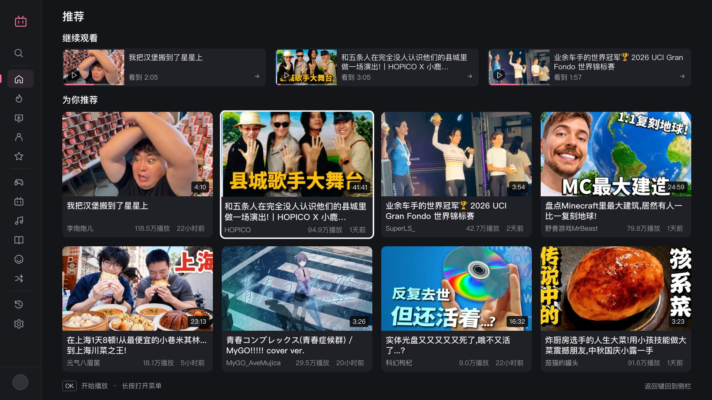
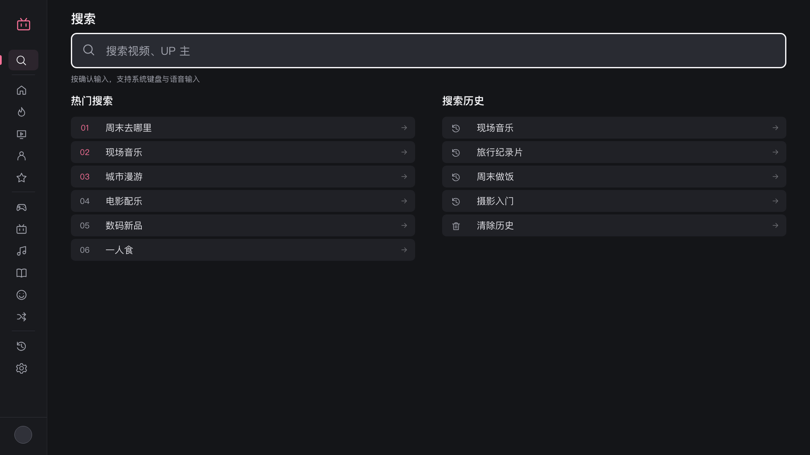
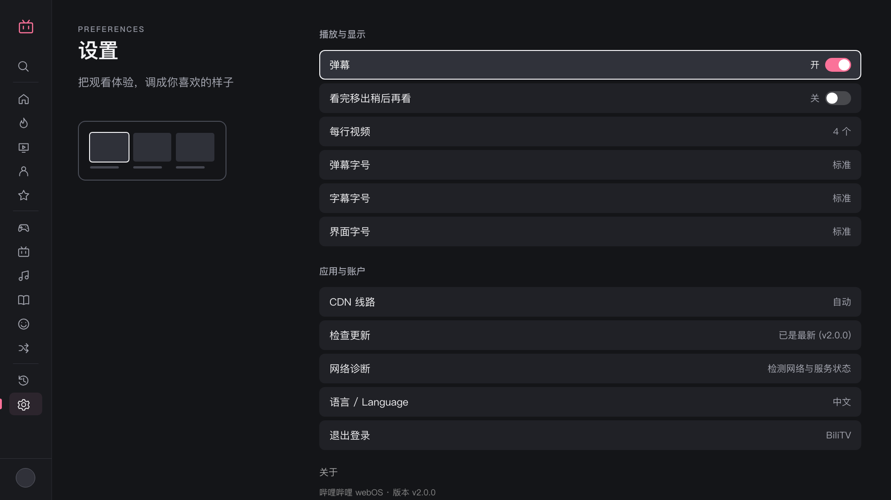
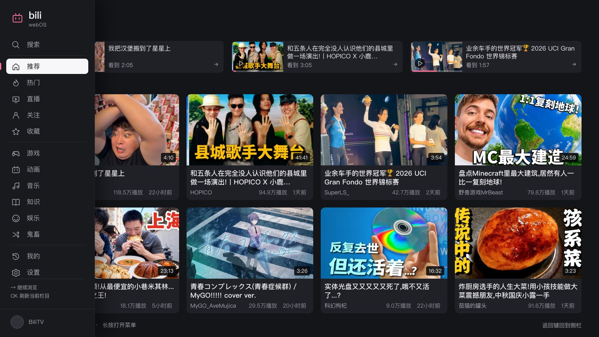

# BiliTV for webOS

### Your Bilibili. A bigger screen.

Videos, live streams, danmaku and your favorite creators — comfortably on your LG TV.

[中文](README.md) · **English**

[**Get BiliTV**](https://github.com/asdf17128/bili-webos/releases/latest) · [**Homebrew Channel**](https://repo.webosbrew.org/apps/com.biliwebos.app/) · [Changelog](CHANGELOG.md)

  

**More room for what you want to watch.**

BiliTV is a free, open-source Bilibili client made for LG webOS TVs. Pick up the remote, find something you love, and settle in. The app runs on your TV; you don't need to leave a computer running.

## Made for the sofa

| | What you can do |
|---|---|
| **Pick up where you left off** | Continue watching from the home screen, or find a video in your watch history. Save something for later with a long press. |
| **Browse without losing your place** | A slim sidebar opens when you need it. Return from the sidebar or player to the card you were browsing. |
| **Make the screen yours** | Choose **2, 3 or 4 videos per row**. Adjust the interface, subtitle and danmaku text sizes separately. |
| **Find your next favorite** | Recommendations, trending videos, followed creators, favorites and six category shortcuts. Search with trending topics, suggestions and recent searches. |
| **Enjoy the whole video** | Up to **4K / 8K, HDR and Dolby Vision**, playback speed controls, chapter markers and thumbnail previews while seeking. |
| **Stay part of the conversation** | Watch with danmaku and subtitles, read comments and replies alongside the video, or drop into a live stream with chat. |

Also included: **bangumi and episode lists**, favorites and Watch Later playlists, **QR-code login**, Magic Remote pointer and wheel support, and **DLNA casting** from compatible phone apps.

Use BiliTV in **English, Español or 中文**. English and Spanish interfaces also offer automatic translation of video titles, subtitles, chapters and danmaku.

*Video quality and availability depend on the source, your Bilibili account, your TV and your region.*

## A closer look

| Find something worth watching | Settle into your own layout |
|---|---|
|  |  |

<strong>A sidebar that gives the screen back to your videos</strong>

Press **Back** to open the sidebar without resetting the list. Press **Right** to return to the same card. Press **OK** on the current section when you want a fresh list.

*Screenshots show the actual 2.0.0 interface in Chinese, with public sample videos and a demo account.*

## Get watching

**Already have Homebrew Channel?** Open it on your TV, find **BiliTV**, and choose Install or Update. [View the listing →](https://repo.webosbrew.org/apps/com.biliwebos.app/)

**Prefer to install the package yourself?** Download the `.ipk` from the [latest release](https://github.com/asdf17128/bili-webos/releases/latest), then install it using [webOS Dev Manager](https://github.com/webosbrew/dev-manager-desktop). See the [Developer Mode guide](https://www.webosbrew.org/devmode/) to connect your TV. No source build is needed.

Homebrew's catalog can take time to catch up with a new release. The latest package is always available from GitHub Releases.

Supports **webOS 5.0 and later**, with community-tested compatibility for **C9 / webOS 4.x**. Codec support depends on the TV. Scan the login QR code with the Bilibili mobile app to access your subscriptions, favorites and history.

## Remote controls

| Action | What happens |
|---|---|
| Direction keys, pointer or wheel | Select content and browse lists |
| Press OK on a card | Start playback |
| Hold OK on a card | Open actions such as following the creator or saving to Watch Later |
| Press Back in a list | Open the sidebar and keep your place; press Right to return to the same card |
| Press OK on the current sidebar section | Refresh the list |
| Press Left or Right during playback | Preview a seek position; OK confirms and Back cancels |
| Press Up or Down during playback | Show the controls; Back closes overlays and controls before leaving playback |

## Privacy

Login information is stored on your TV and used to access your Bilibili account. Update checks contact GitHub without an app-specific device identifier; public download counts provide a rough measure of usage. Translation sends the text to Google's translation service when used.

## Feedback and development

[Report an issue](https://github.com/asdf17128/bili-webos/issues) · [Changelog](CHANGELOG.md) · [Development guide](docs/DEVELOPMENT.md) · [Test cases](docs/TESTCASES.md)

See the [premium playback guide](docs/DOLBY_VISION.md) for quality and device limits, or the [home-network testing guide](docs/NETWORK-TESTING.md) for network troubleshooting. See the [changelog](CHANGELOG.md) and [2.4.0 validation report](docs/RELEASE-2.4.0.md) for release scope and verification limits. Some technical documents are in Chinese.

[Premium badges and automatic quality](docs/MEMBER-EXPERIENCE.md) (test branch; Chinese documentation).

## License

[MIT licensed](LICENSE). Keep the copyright and license notices when distributing modified source or packages. Third-party dependencies and bundled assets retain their own licenses; this license does not grant rights to Bilibili/LG trademarks or imply their endorsement. An independent community project, not affiliated with Bilibili or LG.
