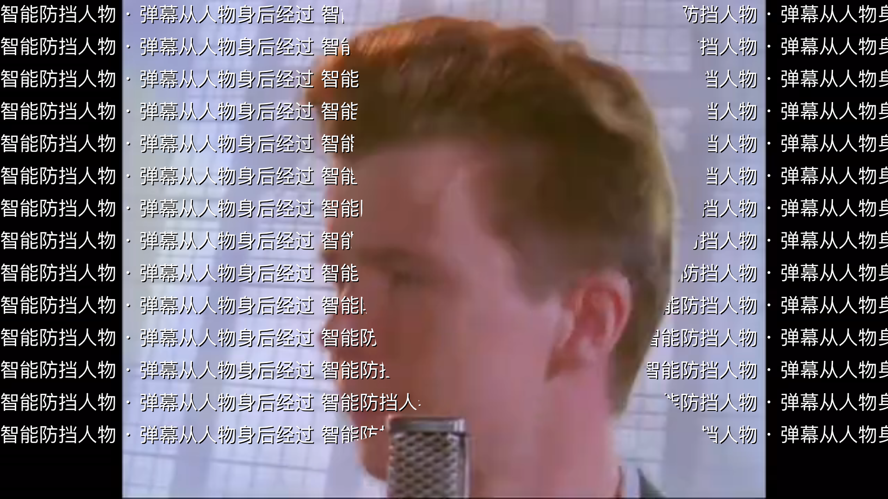
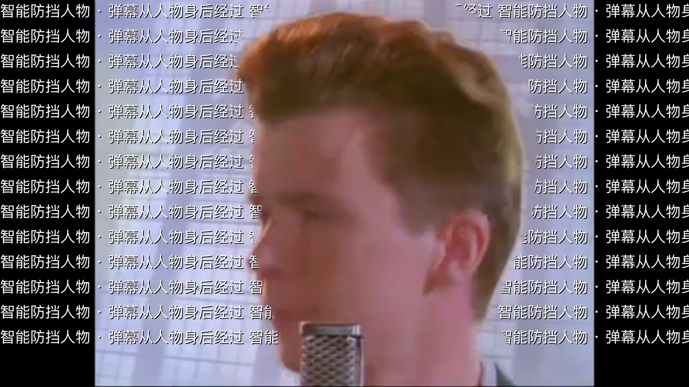

# 人物遮罩优化与本地复测

本轮改善了人物边缘、画面同步、切镜前提前失去保护和解码闪烁；**源遮罩漏人仍然存在，不宣称全程不挡人**。按用户要求，全部测试在本地进行，未连接或操作电视，未发布安装包。

## 同帧截图与连续复查

第一份真实样本 `BV1GJ411x7h7 / cid 137649199` 使用未重封装 MP4 的前 2 MiB，保持原时间戳。以下均暂停在 4.95 秒、使用相同密集测试文字：

| 优化前：此前帧、不扩边 | 优化后：有界预选、小位图扩边 |
|---|---|
|  |  |

以[同帧无弹幕截图](face-base.png)为基准，手工选择脸内矩形 `x=780, y=430, w=220, h=460`，统计 RGB 最大通道差大于 40 的像素：优化前 **4,481 / 101,200**，优化后 **0 / 101,200**。[计算记录](face-region-comparison.json)。这只验证一个固定画面的局部区域，不是全脸、所有帧或所有视频的准确率；脸轮廓外缘仍能看到少量文字。

第二份样本 `BV1Fg411D7Jy / cid 825851971` 使用未重封装 MP4 的前 4 MiB。它揭示了仅使用未来帧的回归：17.90 秒选到即将到来的空遮罩，人物尚未离开就失去保护。现在仅在未来帧为空、当前帧仍有效时保留当前保护；不长期冻结旧形状。

- [17.90 秒](before-cut.png)：人物身体、额头和主要头发仍受保护，诊断选择为 `current-transition`。
- [18.02 秒](after-cut.png)：新镜头清除旧人物洞；当前源为空，明确报告 `unprotected` / `gap`。原视频中的脸部贴纸不能作为保护精度证据。
- [6 倍 CPU 节流的播放中截图](playing-cpu6.png)：复查连续序列 016–020，没有再看到此前嵌套 SVG 图片造成的整层弹幕消失；局部发丝、手部边缘仍有覆盖。截图抽样不能保证所有帧绝无闪烁。

最终代码另对第一份样本 7.75 秒复测：源遮罩没有人物透明洞，仍然不保护该人物，诊断正确显示无保护。[第一样本记录](first-sample.json)、[切镜记录](second-transition.json)、[连续采样](continuous-cpu6.json)。此前的[漏人截图](../2026-11-06-person-mask-visual/source-gap.png)保留为限制案例。

## 改动与时基依据

1. 跟随实际展示帧的 `mediaTime`，旧引擎回退 rAF；100 ms 轮询只负责加载及暂停／缺少帧回调的兜底。
2. 原来严格取此前帧，改为在当前时间之后一至三个刷新间隔内预选首个有效帧，跨当前／下一分段查询。参考[官方播放器的选帧语义](https://s1.hdslb.com/bfs/static/player/main/widgets/npd.314.04671e64.js)，独立实现；没有复制播放器代码，也未添加针对某个视频的固定 100 ms 偏移。当前选择频率上限为 24 Hz，不包含官方的动态帧率调整策略。
3. 空未来帧只能回退到不超过 80 ms 的当前源帧；异步准备变慢时，按实际展示时间清掉过期轮廓。跳转、切源和关闭均隔离迟到结果。
4. 在服务器的小尺寸遮罩上处理透明度边缘，180 像素高的源扩大 2 像素，约相当于 1080p 下的 12 像素留白。最多 65,536 像素、同时准备 1 张、缓存 8 张。只处理遮罩，不读取视频或运行识别模型。
5. 预解码 PNG 直接用于 CSS mask，用独立渐变保留黑边弹幕；避免嵌套 SVG 图片的再次异步解码。缓存淘汰、取消、失败和退出都释放图片。
6. 没有人物洞时报告无保护，避免把“数据加载成功”误报为“人物已被保护”。轮廓占比仅用于判断源是否为空，不代表识别置信度。

两份源的时差方向不同，不能使用统一偏移：

| 样本 | 原始媒体首帧 PTS | 检查的切镜处，源遮罩相对视频 |
|---|---:|---|
| 第一份，25 fps | 21 ms | 7 处均晚 101 ms |
| 第二份，30 fps | 46 ms | 3 处均早 46 ms |

此前第一份重封装片段首帧为 40 ms，多了 19 ms；本轮改用原始字节复核。[第一份时基记录](first-timebase.json)、[第二份时基记录](second-timebase.json)。这些是所检样本的结果，不是 B 站所有片源的固定规律。

## 本地回归结果

| 检查 | 结果 |
|---|---|
| 最终浏览器专项 | **22/22**；真实 CSS 像素、横竖黑边、跨段、网络失败、关闭／切源／跳转隔离、rVFC/rAF、空未来帧及慢解码过期等。[记录](browser-tests.json) |
| 连续变换位图像素 | 上述专项中的 18 次连续截图：背景弹幕像素始终可见，遮罩应用次数大于 20，防止整层弹幕空白回归 |
| 最终代码生命周期压力 | **180 秒、207 轮、828 次跳转**；DOM 与监听器增量均 0，堆增量 446,512 字节，分段缓存不超过 2，位图缓存不超过 8，无页面错误。[记录](lifecycle-soak.json) |
| 位图与释放专项 | **7/7**；软边透明度、尺寸限制、边界保留、无轮廓、取消、共享期限、迟到解码、缓存所有权、无 `Image.decode` 回退。[记录](bitmap-tests.json) |
| 格式与真实源解码 | **7/7**，含两份真实 `.webmask`。[记录](codec-tests.txt) |
| 最终播放集成与弹幕渲染 | 元数据失败／缺失／CID 不符及播放中设置 **4/4**；渲染回归 **13/13**。[集成](integration-tests.txt)、[渲染](render-tests.txt) |
| 最终构建 | Vite 生产构建成功，产物通过 ES2016 语法解析 |

本轮还完整运行过 `bash tools/verify.sh --no-tv --ux`，退出码 0，含真实 Node 0.12 / Node 8 服务测试、UX 74/74、推荐菜单 62/62、账号修复 26/26、加载 84/84、控制栏 42/42、结束行为 26/26、直播加载 15/15 等。**这次全量运行早于最后的空帧保护和直接 PNG 改动**；最终代码通过上表的针对性复测，没有将早先全量结果冒充最终全量结果。

## 性能观察与边界

- 真实小遮罩在 6 倍 CPU 节流下准备 10 张，平均 **10.35 ms**，最大 **18.4 ms**，包括预解码。它不是整帧渲染耗时，也不是电视测量。
- 无截图的 20 秒播放对比：关闭遮罩 600 帧／150 丢帧，开启遮罩 599 帧／0 丢帧。[原始记录](performance-comparison.json)。两阶段按先关后开顺序运行，存在启动和调度影响；**不能据此说开启遮罩让视频更快**，只能记录开启阶段未观察到丢帧。
- 同时抓连续截图的 6 倍 CPU 运行收集 32 个样本，首尾计数差为 1,202 帧／57 丢帧；没有 `waiting`、媒体错误或遮罩请求失败。截图会增加合成开销，不能称为零掉帧；截图前后时间也不是精确画面 PTS。
- 媒体样本为低分辨率原始视频，在 1920×1080 浏览器视口显示。CPU 节流不能代表 webOS 原生视频平面、电视 GPU、旧合成器或 4K 性能。
- 180 秒生命周期压力与短片循环测试均不等于整晚稳定性测试。当前继续保留实验状态与默认关闭。

## 复现

本地启动 Vite 后运行；真实媒体与遮罩保存在本机 `/tmp`，未将媒体文件、账号或签名下载地址写入仓库。自动化使用合成密集文字与固定测试素材，不产生账号操作。

```sh
node tools/test-danmaku-mask.mjs /tmp/bili-mask-rick.webmask /tmp/bili-mask-sample.webmask
MASK_PADDING_REAL_SEGMENT=/tmp/bili-mask-first.gz node tools/test-danmaku-mask-padding.mjs
MASK_SOAK_SECONDS=180 MASK_REAL_SEGMENT=/tmp/bili-mask-first.gz node tools/test-danmaku-mask-browser.mjs
MASK_VIDEO=/tmp/bili-mask-original-head.bin MASK_STILL_TIMES=4.95,7.75 MASK_CAPTURE_BASE=1 node tools/test-danmaku-mask-real.mjs
MASK_VIDEO=/tmp/bili-second-original-head.bin MASK_FILE=/tmp/bili-mask-sample.webmask MASK_STILL_TIMES=17.9,18.02 node tools/test-danmaku-mask-real.mjs
MASK_VIDEO=/tmp/bili-second-original-head.bin MASK_FILE=/tmp/bili-mask-sample.webmask MASK_STILL_TIMES=3 MASK_CPU_RATE=6 MASK_LOOP_END=27 MASK_SCREENSHOTS=1 MASK_REAL_SOAK_SECONDS=40 node tools/test-danmaku-mask-real.mjs
```

最终连续截图原件位于 `/tmp/bili-mask-opt-direct-motion`，本目录保留一张代表画面和全部采样数值；静态复测在 `/tmp/bili-mask-opt-final-stills`、`/tmp/bili-mask-opt-final-transition`。全量日志为 `/tmp/bili-mask-opt-full.log`，最后构建日志为 `/tmp/bili-mask-opt-last-build.log`。本目录的 `lifecycle-soak.json` 比最终专项少一个后来新增的连续变换像素用例、多一个压力用例；两次运行产品代码相同。
