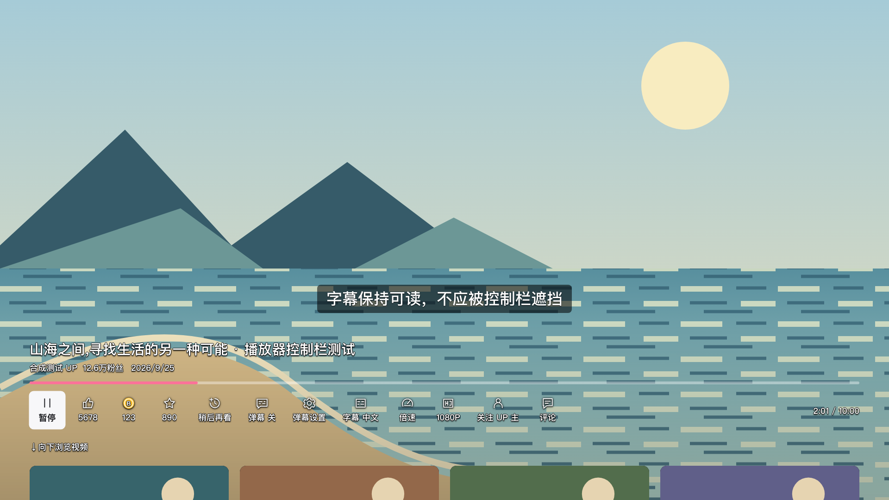
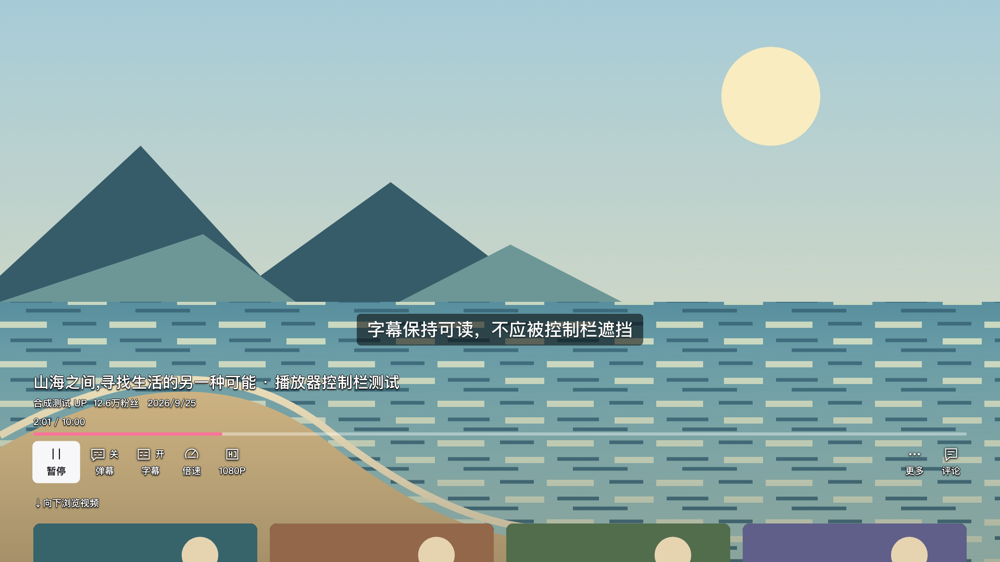

# VOD 播放控制层级整理（2026-11-07）

本轮针对用户明确指出的“常用按钮和信息太散太挤”：将观看时常用操作收在主控制条，把互动和详细设置移入独立“更多”菜单，并将时间与章节信息归到进度区域。实现已落入本地代码；本轮只做本地验证，没有操作电视、安装电视包或发布。

## 已实施的布局

主控制条从左到右为：播放／暂停、弹幕开关、字幕（有字幕轨时显示）、倍速、画质、更多、评论，对应 `play, danmaku, subtitle?, speed, quality, more, comments`。时间和当前章节归入进度区域，不再占用主按钮行。

主层最多从 13 个按钮收为 7 个。弹幕和字幕的开／关状态与图标并排显示，状态文字保留 18px × 界面字号，不会随标签一起省略；按钮按内容分配宽度，在窄屏允许长标签自然分两行，按钮仍保持一排。评论总数继续在打开评论前显示，打开后仍在评论侧栏标题中显示。标题、作者、粉丝数仍属于同一控制层，随整层同步收起。

“更多”使用独立的纵向操作列表：

| 操作 | 保留的行为 |
| --- | --- |
| 点赞、投币、收藏 | 保留三个独立入口、各自状态和数值；点赞短按及长按逻辑继续使用原控制器 |
| 稍后再看 | 保留加入状态和原操作逻辑 |
| 关注 UP 主 | 按作者关系能力显示，保留原关注状态和操作逻辑 |
| 弹幕设置 | 打开现有弹幕设置面板，设置继续即时生效和持久化 |

登录态继续控制点赞、投币、收藏和稍后再看的显示；关注入口继续使用现有可用性判定。移动入口没有改变账号相关操作的权限或请求约束。

菜单与弹幕设置的返回路径为：

```text
主控制条「更多」
  → 更多菜单（上下方向键选择，OK 执行）
    → 弹幕设置
    ← 关闭设置：回到更多菜单的「弹幕设置」条目
  ← 关闭更多：回到主控制条的「更多」按钮
```

“更多”内的指针操作和遥控器操作调用同一套播放器动作。直播控制未调整；推荐卡片保留原有两排布局和 transform 结构，本轮没有借控制条整理重排卡片。

主要实现位于 [PlayerPage.jsx](../../../app/src/player/PlayerPage.jsx)、[PlayerMoreControls.jsx](../../../app/src/player/PlayerMoreControls.jsx)、[playerControls.css](../../../app/src/player/playerControls.css) 和 [playerMoreControls.css](../../../app/src/player/playerMoreControls.css)。

## YouTube 电视端参照与核实范围

参照对象是智能电视／流媒体设备上的 **YouTube 主应用**，不是美国付费直播订阅服务 **YouTube TV**。以下资料在 2026-11-07 查阅，用于确认信息层级和遥控器交互方向；没有访问用户电视上的 YouTube，也不据此声称所有设备、账号或内容类型都使用完全相同的布局。

- [TeamYouTube：Redesigned YouTube Watch Page on TVs，2025-12-11](https://support.google.com/youtube/thread/394085818?hl=en)：官方公告明确描述进度条下方的三组控制——左侧频道／简介／订阅，中间上一项／暂停／下一项，右侧互动／字幕／设置；标题移至左上角且不再可点击，详情通过独立简介按钮进入。本轮借鉴“进度独立、控制分组、详情有入口”，没有照搬其全部按钮或标题位置。
- [YouTube 官方设计文章：Designing a richer YouTube experience for your TVs，2024-03-13](https://blog.youtube/news-and-events/designing-a-richer-youtube-experience-for-your-tvs/)：文章介绍在电视上并排呈现视频与评论／简介，并说明暂停、快退、快进仍应容易操作、遥控器交互应保持简单。本轮据此区分观看操作和需要展开的内容；本文不声称已实现 YouTube 的视频缩小与侧栏联动方案。
- [YouTube 帮助：Explore the YouTube app on your TV](https://support.google.com/youtube/answer/7583931?hl=en)：帮助页说明通过遥控器上／下方向键唤出视频详情，再选择简介、评论或订阅。这支持按需显示入口的交互思路，不是本项目全部键位的直接规范。
- [TeamYouTube：Q2’26 电视端更新，2026-08-17](https://support.google.com/youtube/thread/458858143/q2%E2%80%9926-our-latest-improvements-to-the-youtube-app-on-tvs?hl=en-GB)：更新说明上一项／下一项仍在向所有视频扩展，并新增 Show／Podcast 页签。电视端持续演进，因此本轮引用的是有日期的官方模式，不将某一版截图视为永久规范。

另找到 [YouTube Viewers 官方演示：How to control YouTube on your TV，2025-12-11](https://www.youtube.com/watch?v=u2YVh9h_ipo)。已核实官方视频标题、描述和章节时间戳：0:28 起介绍播放器控件，1:01 起介绍音乐控件；**没有实际逐帧查看演示**，因此没有用它证明具体尺寸、间距、焦点顺序或完整动画行为。

“主层保留哪些 B 站按钮”和“更多菜单如何返回”是结合本项目功能及用户反馈做出的实现选择，不是 YouTube 官方推荐的 B 站布局。

## 本地验证记录

最终结果：[验证摘要](validation-summary.json)、[完整播放器结果与源码哈希](controls-results.json)。完整播放器套件 **52/52 通过**，运行前后源码哈希一致；覆盖主层／更多菜单、独立账号动作、长按取消、设置返回、播放结束和错误交接、评论数量、大字号和评论侧栏、透明度、两排完整卡片、滚轮／遥控动画、六倍 CPU 限速下的动画、自动隐藏、快进、字幕、画质和粉丝数。正式构建通过，7 个 JavaScript 产物全部通过 ES2016 语法解析。构建仍提示部分 chunk 超过 500 kB，见[构建日志](build.log)。

补充结果：[加载与遥控专项 3/3](loading-results.json)、[卡片关注专项 5/5](card-follow-results.json)、[生产 CSS 隔离几何检查](isolated-css-layout-results.json)。后者使用中／英／西语、1080p、720p、1.4 倍字号与评论栏的组合，包含长画质和评论计数；这份 9 组记录属于静态布局检查，不与真实 React 用例合并计数。[中间迭代记录](iterations.json)保留失败和一次因源码变化失效的运行，不把它们当作终验结果。

已完成与入口迁移直接相关的脚本维护：

- [test-player-loading.mjs](../../../tools/test-player-loading.mjs)：关注用例改为从主层进入“更多”、纵向选择关注，并验证关闭后焦点回到主层“更多”；原请求次数断言保留。连同返回后的指针抖动、独立媒体键，本地 mock 筛选结果为 **3/3 通过**。
- [test-tv-ux.mjs](../../../tools/test-tv-ux.mjs)：审查确认其关注用例属于卡片菜单，未受 VOD 控制条调整影响，因此未改。原卡片关注筛选结果为 **5/5 通过**，包括成功、失败、关系读取失败、访客及关闭菜单后的异步完成场景。
- [test-sim.mjs](../../../tools/test-sim.mjs)：登录态三连显示检查改为检查“更多”菜单，稍后再看改为纵向导航；登录校验、`SIM_ACCOUNT_WRITES` 开关及移除前的目标身份断言均保留。该脚本使用真实服务桥与网络，本轮只做语法检查，**没有运行真实账号 sim**。

上述三份脚本的语法检查与修改后的 `git diff --check` 通过。两组已运行的浏览器筛选使用本地 Vite 与 mock 响应，阻断服务桥请求，不连接真实账号。

复现已完成的本地筛选（先启动本地 Vite）：

```sh
CONTROLS_OUTPUT=/tmp/bili-player-controls node tools/test-player-controls.mjs
LOADING_FILTER='creator follow|remote media keys|Back dismissal' node tools/test-player-loading.mjs
UX_FILTER='creator follow' node tools/test-tv-ux.mjs
```

播放器交互套件使用真实 React 页面和可信浏览器键鼠输入，媒体解码与进度由夹具控制；所有非 Vite HTTP 及 WebSocket 均被截获，账号、视频、封面和背景场景都是合成数据。没有进行真实账号操作、电视验证、真实视频解码或长测，也没有重跑未改动的直播／服务端全量套件。构建产物的 ES2016 语法检查不能替代旧版 webOS Chromium 的实机兼容验证。

## 排查与回归要点

- “更多”菜单最初会在播放结束或报错时遗留在画面前，键盘已转向底下的结束／错误页面；已在状态切换时关闭菜单、关闭弹幕设置并取消未完成的点赞长按。两种路径分别验证松键后不会迟到提交账号操作。
- 固定按钮宽度会裁掉英文 Off 和长画质标签。已改为内容分配宽度、独立状态标记，并检查中英西语的大字号和 420px 评论栏。额外几何检查使用生产 CSS 与隔离 HTML，不能当作实际解码或 Dolby 播放验证。
- 测试随入口迁移更新：弹幕设置和关注改从“更多”进入；单行对齐比较按钮中心，排除焦点放大造成的边缘差异。透明度像素采样移至新布局中没有按钮的区域，窗格合成场景补足连续纹理，原透明度与渐变阈值未降低。
- 旧版真实账号模拟脚本的评论数量断言促使保留原来的数量显示，并增加真实 React 页面的中英文窄屏用例。英文计数使用现有 K/M 格式，中文仍为万／亿。

## 截图

以下是本地真实 React 页面截图，视频背景和内容均为合成夹具，不是电视照片或实际视频播放截图。

| 改动前 | 改动后 |
| --- | --- |
|  |  |

[更多菜单](after-more.png) · [720p 大字号＋评论侧栏](after-comments-en-720-large.png) · [保持全尺寸的两排推荐卡片](after-recommendations.png)。改动前的页面状态与源码哈希见[基线记录](before-results.json)。
